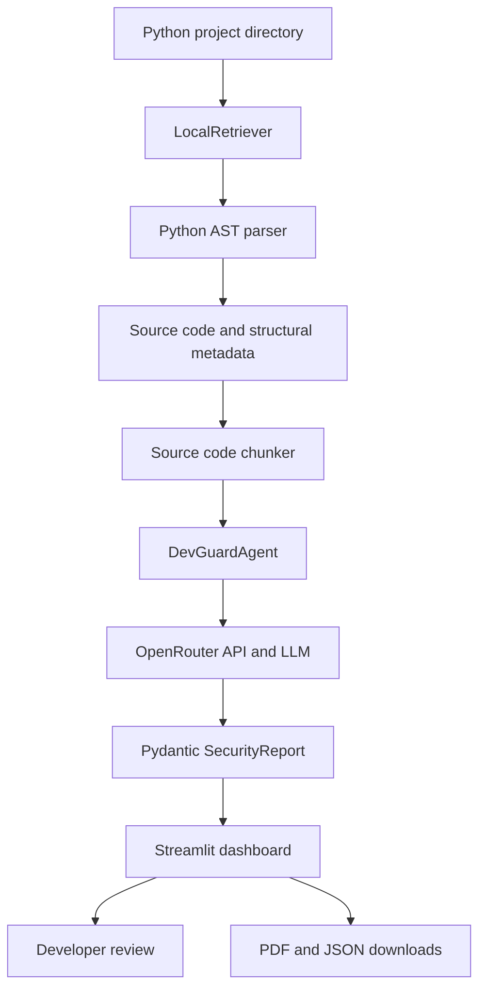

# 🛡️ DevGuard-Agent

**An AI-assisted Python code security analysis system**

[](https://github.com/ChholeBhathure/devguard-agent/actions/workflows/ci.yml)


DevGuard-Agent is a Streamlit-based application that uses a large language model (LLM) to help developers identify potential security issues in source code. It supports code-snippet analysis and scanning of Python project directories. Findings are returned in a structured Pydantic report with severity, evidence, recommendations, and confidence values.

DevGuard is an **AI-assisted review tool**, not a replacement for static analysis tools, security testing, or human code review. Always verify findings before changing code.

## ✨ Features

- **Snippet analysis:** Submit a code snippet through the Streamlit interface and select its language.
- **Python repository scanning:** Discover Python files in a directory, extract structural metadata using Python's Abstract Syntax Tree (AST), and collect source code for analysis.
- **Chunk-based analysis:** Split larger source files into smaller overlapping chunks while tracking their original line ranges.
- **LLM-powered analysis:** Send code chunks to an OpenRouter model for security review.
- **Structured output:** Validate model responses with Pydantic schemas.
- **Fault-tolerant scanning:** Record chunk-level failures and warnings so one failed chunk does not automatically stop the remaining repository analysis.
- **Finding review:** Mark findings as needing review, confirmed, or false positive in the Streamlit interface.
- **Report downloads:** Download repository analysis reports in PDF and JSON formats.
- **Automated tests:** Run the test suite with pytest; GitHub Actions is configured for Python 3.10, 3.11, and 3.12.

## 🧭 How It Works

### Repository analysis flow

1. **Select a project directory.** The retriever walks through the directory and discovers Python files, while skipping configured directories and files above the configured size limit.
2. **Extract code structure.** Python's AST parser collects metadata such as imports, classes, functions, and their line numbers. The retriever also reads the source code.
3. **Create chunks.** The chunker divides source code into manageable sections and retains each chunk's original line range. Adjacent chunks can overlap to preserve context.
4. **Analyze with an LLM.** The agent sends each chunk to the configured model through the OpenRouter API.
5. **Validate the response.** Pydantic validates the returned security report. Repository analysis restores file paths and original line numbers, records failed chunks and warnings, and removes matching findings where a reliable location is available.
6. **Review and export.** The Streamlit dashboard displays the findings and lets the developer record a review status. Repository reports can be downloaded as PDF or JSON.

### Architecture



## 🧰 Technology Stack

| Technology | Purpose |
|---|---|
| Python | Core application and analysis logic |
| Streamlit | Interactive web interface |
| Python AST | Extract structural metadata from Python files |
| OpenRouter API | Connect to the selected LLM |
| OpenAI Python SDK | Send chat-completion requests using the OpenRouter-compatible API |
| Pydantic | Validate structured security findings and reports |
| ReportLab | Generate PDF reports |
| Pytest | Automated testing |
| GitHub Actions | Continuous integration across supported Python versions |

## 📁 Project Structure

```text
devguard-agent/
├── app.py
├── src/
│   └── devguard/
│       ├── agent.py
│       ├── chunker.py
│       ├── config.py
│       ├── parser.py
│       ├── retriever.py
│       ├── report_generator.py
│       └── schemas/
│           └── finding.py
├── tests/
├── .github/
│   └── workflows/
│       └── ci.yml
├── pyproject.toml
├── requirements.txt
└── README.md
```

## 🚀 Getting Started

### Prerequisites

- Python 3.10, 3.11, or 3.12
- An OpenRouter account and API key
- Git

### 1. Clone the repository

```bash
git clone https://github.com/ChholeBhathure/devguard-agent.git
cd devguard-agent
```

### 2. Create and activate a virtual environment

**Windows (PowerShell):**

```powershell
python -m venv .venv
.venv\Scripts\Activate.ps1
```

**macOS / Linux:**

```bash
python3 -m venv .venv
source .venv/bin/activate
```

### 3. Install dependencies

```bash
python -m pip install --upgrade pip
pip install -r requirements.txt
```

### 4. Configure your OpenRouter API key

Create a file named `.env` in the project root:

```env
OPENROUTER_API_KEY=your_openrouter_api_key_here
```

Do not commit your `.env` file or share your API key. The application loads this variable for API access.

### 5. Run the application

```bash
python -m streamlit run app.py
```

Streamlit will display a local URL in the terminal. Open that URL in your browser.

## 🖥️ Using DevGuard

### Snippet Analysis

1. Open the **Snippet Analysis** tab.
2. Select the language that matches the submitted snippet.
3. Paste the code into the input area.
4. Select **Audit Snippet**.
5. Review the summary, severity, evidence, recommendation, and confidence for each finding.

### Repository Analysis

1. Open the **Repository Analysis** tab.
2. Enter the absolute path to a directory that is accessible to the machine running the Streamlit application.
3. Select **Scan Repository**.
4. Review the findings, warnings, and failed chunks.
5. Download the report as PDF or JSON.

**Important:** A Streamlit application running on your own computer can access directories available on that computer. A remotely hosted Streamlit application cannot automatically read a folder from your personal computer just because you enter its local path; the directory must be available to the hosted application's runtime.

## ⚙️ Repository Configuration

DevGuard can read a `.devguardrc.json` file from the target project directory. The current default configuration is:

```json
{
  "ignore_dirs": [
    ".venv",
    "venv",
    "__pycache__",
    ".git",
    "build",
    "dist"
  ],
  "severity_threshold": "low",
  "max_file_size_kb": 500
}
```

- `ignore_dirs`: directory names excluded during traversal.
- `max_file_size_kb`: maximum file size accepted by the retriever.
- `severity_threshold`: configuration value retained in the project settings; do not assume it filters displayed findings unless that behavior is implemented.

## 🧪 Run Tests

Run the automated test suite from the repository root:

```bash
pytest tests/
```

The GitHub Actions workflow is configured to run tests with Python 3.10, 3.11, and 3.12.

## 🔐 Data and Security Notes

- Repository scanning reads Python source files accessible to the application process.
- **Source-code chunks are sent to the configured LLM provider through OpenRouter for analysis.** Do not scan confidential, regulated, or sensitive code unless you are authorized to share it with that provider and have reviewed the provider's data-handling terms.
- Keep API keys in environment variables or Streamlit secrets. Never hard-code keys or commit them to Git.
- LLM-generated findings can be incomplete or incorrect. Review the supplied code evidence and validate each finding independently.

## ⚠️ Current Scope and Limitations

- Repository scanning currently targets **Python files** (`.py`).
- AST parsing extracts structural metadata; it does not itself prove that a vulnerability exists.
- LLM analysis is probabilistic and may produce false positives or miss vulnerabilities.
- Chunking uses an approximate character-to-token ratio, so chunk sizes are estimates rather than exact tokenizer counts.
- A very long individual source line may be split into fragments that share the same original line number.
- Repository analysis uses the project name `Scanned Project` in the current report implementation.
- The application does not automatically fix code or guarantee that a project is secure.

## 🔭 Future Improvements

Potential future work includes improving project-name detection, adding more robust source-code context across chunk boundaries, expanding test coverage with a larger benchmark dataset, improving analysis traceability, and adding support for additional repository languages.

## 📄 License

This project is licensed under the MIT License. See the [LICENSE](LICENSE) file for details.
